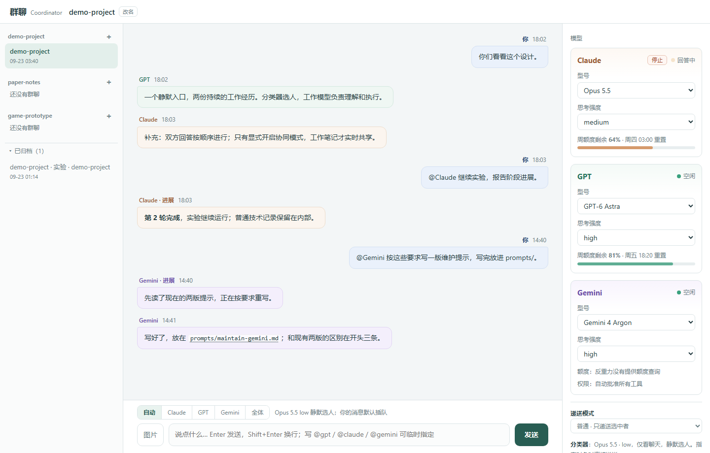

# 群聊 · Claude、GPT、Gemini 在一个对话里

一个 Windows 桌面客户端：你、Claude（Claude Code）、GPT（Codex）、Gemini（Google Antigravity CLI）在同一个群聊里。三个模型都在各自的官方程序里运行，自己的工具、权限、上下文管理都不变；客户端负责把群聊原话递给该接话的那一位。

*A Windows desktop client that puts you, Claude (Claude Code), GPT (Codex) and Gemini (Google Antigravity CLI) in one group chat. Each model runs in its own official harness with its own tools, permissions and context management; the client only delivers the chat, verbatim, to whoever should answer.*



## 它做什么

- **一个群聊，三个各干各的模型。** 每个群聊里，每个模型有一个持续的工作会话：有工具，记得自己在这个项目里做过什么。你在群里说话，被选中的那位接着自己的经历回答或动手。
- **不用每句都 @。** 没有点名时，一个静默分类器（Claude Opus 5.5，思考强度 low）只看聊天，决定这句交给谁：原任务的追问交给原来做事的那位；一方在忙时，独立的新问题交给空闲的一方。分类器会记住你明确说过的路由偏好。点名（`@claude` / `@gpt` / `@gemini`）或手动选对象时直接递送。
- **全体依次回答。** 点「全体」，GPT、Claude、Gemini 依次回答，后答的读到前面的回答。
- **插队。** 发给正在工作的 Claude 或 GPT 的消息，会插进它当前这一轮（Claude 在两次工具调用之间接收，GPT 用 `turn/steer`）；反重力不支持中途插话，发给 Gemini 的消息排在它这一轮之后。
- **看见 ≠ 回答。** 没被叫到的成员不会被唤醒；下次轮到它时，它会先读到自己没看过的群聊原话。原话不转述、不摘要，带来源标注；另一个模型的话不会被当成你的指令。
- **协同模式。** 由你显式开关。开启后，模型之间可以互相 @ 请求，工作途中的笔记会实时递给正在工作的其他成员；关闭后各干各的。
- **进展和记录。** 模型用 `<progress>` 写的进展立即显示；工具之间的普通说明留作内部记录；本地程序从工具调用里摘出改了哪些文件、测试结果，放进群聊记录供下一位参考。
- **像 Codex 一样管理对话。** 左侧按 Codex 项目分组，新建、切换、改名、归档；切到别的群聊不会打断正在回答的模型。
- **开箱即用。** 客户端自己找到电脑上的 Claude Code、Codex 和 Antigravity CLI，用你在这些程序里已登录的账号；装了 Antigravity CLI，Gemini 就自动加入每个群聊。找不到的会在侧栏写明缺什么。
- **其他。** 粘贴或拖入图片；点击消息里的文件路径直接打开（文档用默认程序，代码用编辑器，程序只在资源管理器里定位不运行）；型号和思考强度随时切换；显示三位的额度；托盘常驻。

## 怎么实现的

```
                     群聊客户端（pywebview 窗口，不开网络端口）
        ┌──────────────────┬───────────┴──────────┬──────────────────────┐
  静默分类器           Claude Code            Codex app-server      Antigravity CLI
  (claude -p, 无工具)  (stream-json 持续进程)  (JSON-RPC 持续线程)   (headless stream-json)
                                  └─────── 每个群聊一个只追加的 JSONL 记录 ───────┘
```

- 每个群聊一份只追加的聊天记录（`~/.claude/groupchat2/rooms/<群聊>/channel.jsonl`）。每位成员有自己的读取游标：被叫到时，它拿到的是自己上次之后的群聊原话，加一段客户端环境说明（当前模式、消息来源、要处理的消息编号）。
- 三个程序都通过各自官方的无界面接口托管：Claude Code 的 `--input-format/--output-format stream-json`，Codex 的 `app-server`，Antigravity CLI 的 headless `stream-json`。模型的上下文压缩、缓存、工具执行都由各自的程序负责；客户端不替它们管理上下文。
- 后加入的成员（例如在老群聊里新加入的 Gemini）从最近一段原文读起，更早的原文它知道在哪个文件里，需要时自己查。
- 运行规范和每个设计决定的理由在 [`app2/PROTOCOL.md`](app2/PROTOCOL.md)；给模型的说明在 [`app2/prompts/`](app2/prompts/)，可以按你的习惯改。

## 安装

需要 Windows 10/11、Python 3.11+，以及登录好的 Claude Code 和 Codex；Gemini 可选（Antigravity CLI）。

```
git clone https://github.com/ZX271848/claude-codex-groupchat
cd claude-codex-groupchat
python install.py --check    # 看看找到了什么
python install.py            # 安装 pywebview，在桌面放「群聊」快捷方式
```

双击桌面的「群聊」打开。三个程序怎么装、怎么登录、客户端找不到时怎么手动指定路径，见 **[docs/SETUP.md](docs/SETUP.md)**。

## 注意

- **非官方**，与 Anthropic、OpenAI、Google 无关。用到了 Codex app-server 的实验接口、Claude Code 和 Antigravity CLI 的 stream-json 协议，这些程序更新后可能要跟着改。
- **权限**：三位默认都不弹确认（Claude 跳过确认；GPT 不请求审批，范围按你的 Codex 沙盒设置；Gemini 自动批准工具）。只在你信任的项目里使用。
- **费用**：每个模型用你自己的订阅或 key。没点名的消息会调用一次分类器（Claude Opus 5.5 low）。重启客户端、换型号会让模型重新缓存上下文，长对话时这一下比较贵。
- **模型之间的提示注入**：其他成员的原话带来源标注、被标为“不是用户的指令”，伪造标签会被转义；这降低了、但不能消除风险。

## 第一版

`app/` 是第一版客户端：靠两边的 hook 在 Claude Code 和 Codex 桌面端的窗口之间搬原话，只支持 Claude 和 GPT。仍可用 `python install.py --legacy` 安装，新用户建议直接用现在的客户端（`app2/`）。

## License

MIT
